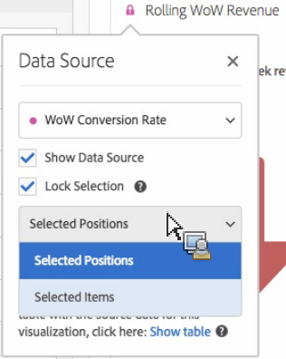

# Gestione delle origini dati {#manage-data-sources}

>[!CONTEXTUALHELP]
>id="workspace_freeformtable_lockselection"
>title="Blocca selezione"
>abstract="Abilita questa impostazione per bloccare la visualizzazione nelle posizioni o gli elementi selezionati nell’origine dati."

>[!CONTEXTUALHELP]
>id="workspace_freeformtable_lockselection_showtable"
>title="Mostra tabella"
>abstract="Selezionando **[!UICONTROL Show table]** viene generata una nuova origine dati per la visualizzazione corrente, separata dall&#39;origine dati originale."

>[!CONTEXTUALHELP]
>id="workspace_freeformtable_showtable"
>title="Mostra tabella"
>abstract="Seleziona **[!UICONTROL Show table]** per generare una nuova origine dati per la visualizzazione corrente, separata dall&#39;origine dati originale."

Ogni visualizzazione in Analysis Workspace si basa su un’origine di dati, in genere una tabella a forma libera. La sincronizzazione delle visualizzazioni consente di controllare quale tabella a forma libera o origine dati corrisponde a una visualizzazione e se la visualizzazione rimane bloccata su righe specifiche della tabella.

>[!TIP]
>
>Puoi individuare le visualizzazioni correlate dal colore del  accanto al titolo delle visualizzazioni. Colori uguali indicano che le visualizzazioni si basano sulla stessa origine dati.
>

<!--
**Tip:** You can tell which visualizations are related by the color of the dot next to the title. Matching colors mean that visualizations are based on the same data source.

Managing a data source lets you show the data source or lock the selection. These settings determine how the visualization changes (or doesn't change) when new data comes in.

1. [Create a project](/help/analyze/analysis-workspace/home.md) with a data table and a [visualization](/help/analyze/analysis-workspace/visualizations/freeform-analysis-visualizations.md).
1. In the data table, select the cells (data source) you want to associate with the visualization.
1. In the visualization, click the dot next to the title to bring up the **[!UICONTROL Data Source]** dialog. Select **[!UICONTROL Show Data Source]** or **[!UICONTROL Lock Selection]**.

   

   Synchronizing a visualization to a table cell creates a new (hidden) table and color-codes the synchronized visualization with that table.

>[!BEGINSHADEBOX]

See  [Data source settings](https://video.tv.adobe.com/v/23729?quality=12&learn=on){target="_blank"} for a demo video.

>[!ENDSHADEBOX]

-->

## Configurare le impostazioni dell’origine dati {#configure}

1. In Analysis Workspace, vai alla visualizzazione di cui desideri configurare le impostazioni di origine dati o blocco.

1. Passa il puntatore del mouse sulla visualizzazione, quindi seleziona l&#39;icona **[!UICONTROL Settings]** .

1. Seleziona la scheda **[!UICONTROL Data source]**.

   

1. Configura una delle seguenti impostazioni:

   | Impostazione | Descrizione |
   | --- | --- |
   | **[!UICONTROL Data source]** | Seleziona l’origine dati su cui si basa la visualizzazione. |
   | **[!UICONTROL Linked visualizations]** | Elenca tutte le visualizzazioni collegate all’origine dati (tabella a forma libera). |
   | **[!UICONTROL Show data source]** | Mostra o nascondi l’origine dati (tabella a forma libera) corrispondente alla visualizzazione. |
   | **[!UICONTROL Lock selection]** | Blocca la visualizzazione sulle righe attualmente selezionate nell&#39;origine dati, quindi seleziona **[!UICONTROL Selected positions]** o **[!UICONTROL Selected items]**. Vedi [Blocca selezione](#lock-selection). |

## Blocca selezione {#lock-selection}

Il blocco della selezione mantiene una visualizzazione incentrata sulle righe selezionate nell’origine dati, anche quando la tabella cambia. Ad esempio, la tabella cambia quando la ordini o filtri, ne modifichi l’intervallo di date o applichi un segmento. Una visualizzazione bloccata mostra  accanto al titolo.

Se i segmenti, le dimensioni o le metriche nell&#39;origine dati cambiano e i dati bloccati non sono più visibili, selezionare **[!UICONTROL Show table]** per generare una nuova origine dati per la visualizzazione, separata dall&#39;origine dati originale.

Quando bloccate la selezione, scegliete una delle seguenti opzioni:

| Opzione | Descrizione |
| --- | --- |
| **[!UICONTROL Selected positions]** | Blocca la visualizzazione alle **posizioni** delle righe selezionate nell&#39;origine dati. Queste posizioni continuano a essere visualizzate, anche se gli elementi in esse contenuti cambiano. Ad esempio, seleziona questa opzione per mostrare sempre i primi cinque nomi di campagna nell’origine dati, indipendentemente dalle campagne in cui si trovano.  Se blocchi le righe di suddivisione e queste non sono più nella tabella, la visualizzazione non viene visualizzata. Per visualizzarla nuovamente, aggiorna la tabella (ad esempio l’intervallo di date, i segmenti o i filtri) o la selezione dei blocchi. |
| **[!UICONTROL Selected items]** | Blocca la visualizzazione agli **elementi** specifici selezionati nell&#39;origine dati. Questi elementi continuano a essere visualizzati, anche se la loro classificazione nella tabella cambia. Ad esempio, seleziona questa opzione per mostrare sempre gli stessi cinque nomi di campagna, indipendentemente dalla loro classificazione. |
