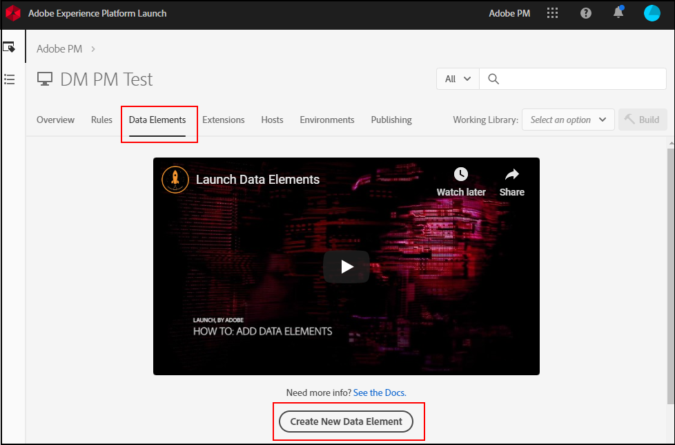

# Mappatura di oggetti del livello dati su elementi di dati

Una volta che la tua organizzazione ha stabilito e implementato un livello dati sul sito, puoi mappare gli oggetti del livello dati agli elementi dati all’interno dei tag.

## Prerequisiti

[Crea un livello dati](../prepare/data-layer.md): assicurati che nel tuo sito esista un livello dati. Sebbene sia tecnicamente possibile mappare qualsiasi oggetto JavaScript o raschiare elementi CSS direttamente dalla pagina, Adobe consiglia questa procedura come ultima risorsa. Se il layout del sito cambia, i selettori CSS utilizzati nei tag cessano di funzionare, causando la perdita di dati.

## Utilizzare i tag per creare elementi dati

[Gli elementi dati](https://experienceleague.adobe.com/docs/experience-platform/tags/ui/data-elements.html?lang=it) sono componenti di Raccolta dati di Adobe Experience Platform che puoi utilizzare in tutto lo strumento. Puoi assegnare valori di variabili nell’estensione Adobe Analytics utilizzando gli elementi dati.

Nei passaggi seguenti viene utilizzata l&#39;estensione [Adobe Client Data Layer](https://experienceleague.adobe.com/it/docs/experience-platform/tags/extensions/client/client-data-layer/overview), che deve essere installata nella proprietà tag.

1. Accedi a [Raccolta dati Adobe Experience Platform](https://experience.adobe.com/data-collection) utilizzando le credenziali Adobe ID.
1. Seleziona la proprietà tag desiderata.
1. Selezionare la scheda **[!UICONTROL Data Elements]**, quindi selezionare **[!UICONTROL Add Data Element]**.

   

1. Immettere un nome per l&#39;elemento dati, ad esempio `Page name`.
1. Nell&#39;elenco a discesa **[!UICONTROL Extension]**, selezionare **[!UICONTROL Adobe Client Data Layer]**.
1. Nell&#39;elenco a discesa **[!UICONTROL Data Element Type]**, selezionare **[!UICONTROL Data layer computed state]**.
1. In **[!UICONTROL Return value]**, seleziona **[!UICONTROL Specific path]**, quindi immetti il percorso del valore nel livello dati, ad esempio `page.name`. Per convalidare un percorso, esegui `adobeDataLayer.getState("page.name")` nella console del browser.
1. Seleziona **[!UICONTROL Save]**.

Utilizza questi elementi dati nelle regole che attivano l&#39;evento **[!UICONTROL Data layer push]** dell&#39;estensione, in modo che Data Layer abbia caricato e contenga i dati provenienti dal push. Vedi [Tipi di elementi dati](https://experienceleague.adobe.com/en/docs/experience-platform/tags/extensions/client/client-data-layer/data-element-types#computed-state).

### Livelli di dati basati su oggetti {#object-based}

Se il livello dati è un oggetto JavaScript, ad esempio un oggetto CEDDL `digitalData`, utilizzare il tipo di elemento dati **[!UICONTROL JavaScript Variable]** dell&#39;estensione **[!UICONTROL Core]**. Immettere il percorso del valore, ad esempio `digitalData.page.pageInfo.pageName`. Questo tipo di elemento dati non può leggere Adobe Client Data Layer, che memorizza i suoi dati in uno stato calcolato invece che nelle proprietà dell’oggetto.

## Passaggi successivi

[Mappatura di elementi dati su variabili di Analytics](elements-to-variable.md): assegna elementi dati a variabili di Analytics in modo da poterli utilizzare come dimensioni in Analysis Workspace.
